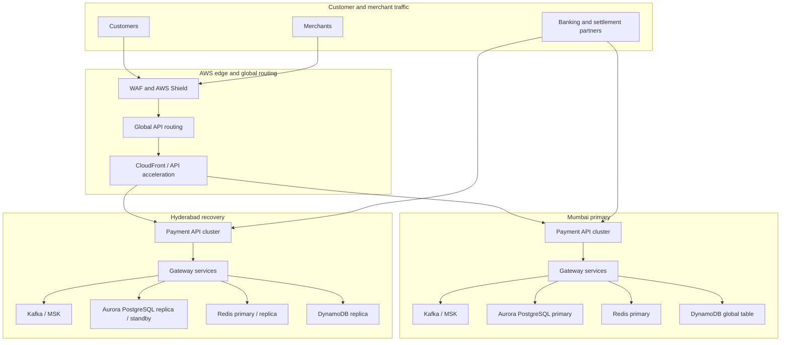

# Project 1C: Multi-Region DR Architecture for PaySecure Gateway Private Limited

## Executive summary

This project defines a two-region disaster recovery architecture for a fictional payment aggregator operating from AWS Mumbai. It is designed to support the regulatory target of **99.99% service availability**, **RPO under one minute**, and **RTO under five minutes** by Q3 2026.

The proposed design uses:

- **Active-active** regional deployment for stateless payment gateway services, API endpoints, edge routing, and asynchronous processing.
- **Active-passive database operation** for the source-of-truth payment ledger, with Aurora PostgreSQL regional failover and controlled promotion to the recovery region.
- **Active-active regional queues and cache layers** where bounded data loss and replay are acceptable.
- **Strict transaction idempotency, audit logging, and replay controls** for every payment and settlement event.
- **Automated failover orchestration**, regional health checks, and 12 tested recovery runbooks.

The architecture uses **AWS Mumbai (ap-south-1)** as the primary production region and **AWS Hyderabad (ap-south-2)** as the active recovery region. The design includes a documented fallback to a third-party managed recovery environment if both AWS India regions become unavailable, but the primary design remains two-region because the target is achievable within one operationally controlled region pair.

## Critical assumptions

- The current system processes approximately **3.2 million transactions per day**, equivalent to about **37 transactions per second on average**, with higher sustained peaks.
- Peak-event periods require dedicated capacity and failover readiness rather than relying on a single burstable pool.
- The payment ledger, settlement state, merchant balances, and transaction reconciliation records are transactional and must not be exposed to unsupported write conflicts.
- The design assumes that transaction authorization, settlement, merchant onboarding, and dispute records can be made idempotent.
- All encryption keys are managed in AWS KMS and backed by an approved key-rotation policy.
- Network paths, DNS, and identity services are protected by regional routing, health checks, and failover automation.
- The architecture is a design baseline, not legal advice. Final implementation must be reviewed by RBI, PCI-QSA, and relevant payment-network specialists.

## Target resilience objectives

| Objective | Target | Design control |
|---|---:|---|
| Service availability | 99.99% | Two-region active-active edge and application services |
| Annual downtime allowance | 52.6 minutes | Regional failover and automated recovery |
| Recovery point objective | < 1 minute | Aurora continuous replication and transaction journal |
| Recovery time objective | < 5 minutes | Pre-provisioned recovery infrastructure and automated promotion |
| Failover confidence | 99.9% for tested paths | Scheduled failover exercises and automated validations |
| Regional outage detection | < 30 seconds | Multi-layer health probes and traffic-routing automation |
| Data restoration | < 60 minutes | Cross-region continuous replication and prevalidated backups |

> These targets are design commitments. They require measured operational testing, capacity verification, and evidence from production failover drills.

## Architecture overview

## Primary design choices

### Regional placement

- **Mumbai:** production and transaction-accepting region.
- **Hyderabad:** active recovery and second active traffic region.
- **Routing:** weighted DNS and API gateway routing with health-based failover.
- **Infrastructure:** immutable infrastructure, IaC, and image-based deployment for both regions.

### Transaction processing model

1. A merchant request is accepted by the nearest healthy regional API endpoint.
2. The service validates merchant identity, routing, payment network, and schema.
3. The request is assigned a payment transaction ID and a deterministic idempotency key.
4. The transaction is persisted to Aurora PostgreSQL in the local region.
5. A payment event is emitted to Kafka for downstream authorization, settlement, notification, reconciliation, and fraud processing.
6. Reads use region-local Redis and Aurora read replicas where consistency allows.
7. Cross-region replication is continuous for data recovery.
8. A failed region redirects traffic only after all transaction state is verified as recoverable.

### Availability strategy

- Stateless application components run in both regions.
- Regional API gateways expose the same product endpoints and security policies.
- Global load balancing uses latency-aware routing and health checks.
- Kafka is deployed in both regions with replication for replayable events.
- Aurora is deployed in one active writer and one cross-region replica.
- Redis uses regional primary replication and a failover-safe cache strategy.
- DynamoDB global tables maintain merchant configuration and transient operational state.

## Shared operational controls

- AWS Organizations with separate accounts for production, recovery, security, and operations.
- IAM identity center with MFA and least-privilege role separation.
- GuardDuty, Macie, Security Hub, and Config for security monitoring.
- AWS KMS and Secrets Manager with regional and cross-region key policies.
- CloudWatch, OpenTelemetry, and a central log analytics workspace.
- Automated remediation through Step Functions and Systems Manager Run Command.
- Immutable change control through Git, policy-as-code, and change approval gates.

## Critical watchlist

The design addresses the following failure conditions:

1. Complete regional outage.
2. Partial service outage in one region.
3. Aurora writer failure or inability to elect a new writer.
4. Database split-brain.
5. Kafka leader or broker loss.
6. Kafka partition unavailability.
7. Redis failover and stale data.
8. DynamoDB replication lag or delayed global item convergence.
9. DNS or network routing failure.
10. Merchant traffic surge above designed capacity.
11. Security compromise or data theft.
12. Regional dependency failure, such as a major cloud service outage.

## Implementation phases

### Phase 1: Design and security baseline

- Confirm AWS accounts and region availability.
- Define IAM boundaries and key management.
- Establish network segmentation and private connectivity.
- Create the resilience and observability baseline.

### Phase 2: Active-active workload deployment

- Deploy stateless gateway components to both regions.
- Configure global routing and health checks.
- Train service-level automatic scaling.
- Establish failover tests for APIs and workers.

### Phase 3: Data replication

- Configure Aurora Global Database or equivalent cross-region replication.
- Configure DynamoDB Global Tables.
- Configure Redis replication and failover.
- Configure MSK replication and consumer offsets.

### Phase 4: Recovery automation

- Implement failover playbooks and approval gating.
- Run non-production chaos tests.
- Validate RTO, RPO, and throughput.
- Create rollback rules and capture evidence.

### Phase 5: Operational readiness

- Execute monthly failover drills.
- Conduct quarterly table-top reviews and simulated board sessions.
- Publish post-incident reports and remediation backlog.
- Confirm regulatory control evidence and audit logs.

## Deliverables

- [Architecture overview](docs/architecture.md)
- [Reference infrastructure topology](docs/infrastructure.md)
- [Component replication strategies](docs/replication.md)
- [Twelve disaster recovery runbooks](docs/runbooks.md)
- [Compliance control matrix](docs/compliance.md)
- [Business continuity board presentation](docs/board-presentation.md)
- [Implementation and testing roadmap](docs/roadmap.md)
- [Risk register and acceptance criteria](docs/risk-register.md)
