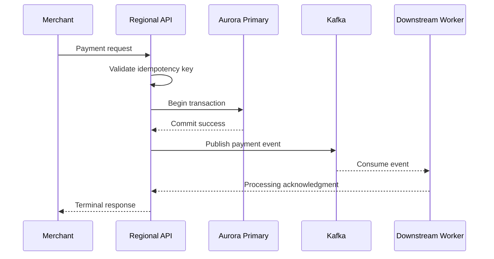

# Multi-region DR architecture

## 1. Scope and system model

PaySecure Gateway processes payment authorization, tokenization, reconciliation, and settlement. The architecture separates transaction-processing channels from non-transactional data to allow independent availability controls.

### 1.1 Regional design

| Region | Role | Capacity posture |
|---|---|---|
| Mumbai (ap-south-1) | Primary production region | Continuous active workload and primary Aurora writer |
| Hyderabad (ap-south-2) | Active recovery and secondary production region | Warm-ready services, read replicas, Kafka ingestion, and scaled workers |
| Additional future region | Optional third-region escape | Only for regional catastrophe and cost-sensitive recovery |

The preferred architecture is **active-active for stateless components and active-passive for the transactional ledger**. This gives the merchant-facing service resilience without allowing different regions to independently commit conflicting financial transactions.

## 2. Active-active services

### 2.1 API and gateway layer

- Regional API Gateway endpoints are published through a global traffic manager.
- Health checks validate HTTPS, subnet reachability, database readiness, and dependency health.
- Traffic is weighted 70/30 toward Mumbai/Hyderabad during normal operation.
- In an outage, routing shifts to the surviving region.
- All APIs use strict TLS 1.2 or above.
- API authentication uses short-lived signed tokens or mTLS for service-to-service requests.
- Requests are idempotent through a deterministic transaction key.

### 2.2 Application services

Stateless services deployed to both regions include:

- Merchant onboarding and validation.
- Payment orchestration.
- Routing to acquiring and issuing networks.
- Fraud and risk scoring.
- Tokenization and vault services.
- Notification and webhooks.
- Reconciliation and settlement preparation.
- Operational dashboards and audit APIs.

Each service uses:

- Auto Scaling and connection pooling.
- Regional health signals.
- Short-lived sessions and stateless state stores.
- Structured logs and OpenTelemetry traces.
- Circuit breakers and queue-based backpressure.

## 3. Transactional data architecture

### 3.1 Aurora PostgreSQL

Aurora PostgreSQL remains the durable source of truth for:

- Payment authorization and settlement transactions.
- Merchant balances.
- Ledger and journal entries.
- Disputes and chargebacks.
- Network response records.
- Audit and compliance evidence.

The preferred pattern is:

1. Primary Aurora cluster in Mumbai.
2. Cross-region Aurora replica in Hyderabad.
3. A replication lag threshold of **under 10 seconds** during normal operation.
4. Automated failover to a designated new primary.
5. Application-level promotion and transaction validation after failover.
6. No application-level writes to the standby.

Aurora Global Database supports cross-region continuous replication across the formerly separate clusters. The implementation must validate that the chosen engine version supports the required failover and recovery functions at the time of deployment.

### 3.2 Transaction consistency controls

- Every payment transaction has a unique global transaction ID.
- Every request uses an idempotency key scoped to merchant, transaction type, and payment reference.
- Duplicate requests return the existing transaction outcome.
- Database inserts use atomic transactions.
- Ledger writes are append-only and immutable after final posting.
- Every financial state transition emits an event with the transaction ID, source, previous state, and new state.
- An after-failover reconciliation process verifies ledger totals against Kafka and settlement jobs.

### 3.3 Read and write routing

## 4. Data replication matrix

| Component | Primary store | Secondary store | Replication type | Consistency target | Recovery use |
|---|---|---|---|---|---|
| Aurora PostgreSQL | Mumbai | Hyderabad | Cross-region continuous | RPO < 1 minute | Primary failover |
| DynamoDB | Mumbai + Hyderabad | Global table peer | Near-continuous asynchronous | Manager-defined business lag | Merchant configuration and operational state |
| ElastiCache Redis | Mumbai | Hyderabad | Active-active or replication | Cache-only, tolerates stale data | Session and operational cache |
| Apache Kafka | Local MSK cluster | Remote MSK cluster | MSK Replicator | Event order and replay | Downstream processing recovery |
| Object storage | Regional S3 | Cross-region replication | Batch or event-based | Recovery data | Backups and audit evidence |

## 5. DynamoDB strategy

DynamoDB Global Tables run in both regions for:

- Merchant profiles.
- Payment-instrument tokens.
- Configuration and rules.
- Routing endpoints and network preferences.
- Operational state and recently processed records.

Business-critical payment ledgers and settlement balances remain in Aurora. DynamoDB is not used as the primary ledger because its eventual consistency model cannot support all financial-account invariants without additional application controls.

## 6. Redis strategy

- Use high-availability Redis with a primary and replica per region.
- Use a regional cache for session, rate-limit, and configuration state.
- Key invalidation uses versioned cache keys when configuration changes.
- Use a short TTL for ephemeral data.
- For failover, application services must treat Redis as best-effort state and must not rely on cached values for final authorization decisions.
- Never store payment-account balance or ledger state in Redis as the primary source of truth.

## 7. Kafka strategy

- Kafka is deployed in both regions.
- Producers write locally to the regional cluster.
- MSK Replicator copies partitioned events to the peer region.
- Each event includes a transaction ID and event sequence number.
- Consumers process idempotently using the transaction key and a deduplication store.
- If the local region fails, consumers continue in the surviving region from the replicated event stream.
- Kafka consumers must be able to replay events without generating duplicate settlements.

## 8. Network and security design

### 8.1 Network

- Separate VPCs for production, recovery, and shared services.
- Private subnets for application and data services.
- Dedicated subnets for Aurora, MSK, and Redis.
- Private connectivity with AWS Direct Connect or VPN where required.
- Region-specific security groups and NACLs.
- DDoS protection and WAF at edge.

### 8.2 Identity

- Central identity provider with MFA.
- Regional IAM roles scoped to the minimum required account, VPC, and service operations.
- No static production credentials.
- Least-privilege service accounts for replication and failover.
- Break-glass accounts, protected by dual approval and logging.

### 8.3 Encryption

- TLS for all client and service connections.
- AWS KMS with customer-managed keys.
- Regional key separation for production data and backup material.
- Key rotation at least annually, with immediate rotation after suspected compromise.
- Secrets stored outside source control and accessed through managed secrets services.

## 9. Monitoring and automation

### 9.1 Guardrail metrics

Every service publishes:

- API availability and latency.
- Payment authorization success rate.
- Queue depth and consumer lag.
- Aurora replication lag.
- Kafka replication lag.
- Redis failover events.
- DynamoDB replication lag.
- Transaction reconciliation difference.
- Regional feature health.

### 9.2 Automated response

A failover orchestrator must:

1. Detect sustained regional failure.
2. Confirm the failure is not a network partition.
3. Freeze nonessential writes in the failing region.
4. Promote the recovery infrastructure.
5. Update DNS and routing.
6. Validate transaction and reconciliation state.
7. Re-enable transactions in order.
8. Record a formal incident timeline.

## 10. Operational acceptance criteria

A deployment is accepted only when:

- Regional failover works in a test environment without manual database restoration.
- RPO and RTO are measured and recorded.
- There is no unsupported write to the Aurora standby.
- Kafka replay correctly produces exactly one financial outcome per idempotency key.
- Recovery services complete reconciliation within the approved threshold.
- Security controls remain effective during failover.
- Break-glass access is logged and independently reviewed.
- Recovery infrastructure is tested at least quarterly.

## 11. Remaining design decisions

- The exact Aurora replication mode and engine version must be selected after a performance and failover test.
- The production database failover authority must be clearly assigned to a single incident commander.
- The organization must determine whether a global transaction ID is required for every payment or only for regulatory audit events.
- Merchant-specific SLOs must be defined before final routing weights are set.
- A legal review must confirm whether payment-network-specific data can be replicated to a second Indian region under current contractual limits.
