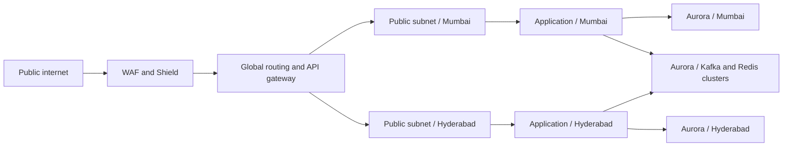

# Reference infrastructure topology

## 1. Account and security structure

| Account | Purpose |
|---|---|
| Shared Services | IAM federation, KMS, Secrets Manager, audit logging |
| Production Mumbai | Transaction processing and primary AWS account |
| Production Hyderabad | Recovery and region-active workload account |
| Security | GuardDuty, Security Hub, WAF, vulnerability management |
| Operations | Monitoring, automation, change control, incident response |
| Backup and Archive | Backups, long-term retention, and investigation evidence |

Each account uses separate AWS Organizations organizations or a controlled multi-account structure. All production changes pass through infrastructure-as-code, peer review, and automated policy enforcement.

## 2. Network topology

## 3. Regional service layout

### Mumbai

- API and payment gateway servers in multiple availability zones.
- Aurora writer cluster with at least three AWS AZs.
- Read replicas and cache nodes in separate AWS AZs.
- Kafka brokers across three AZs.
- DynamoDB Global Table peer with Hyderabad.
- Static assets and object backups in durable S3 storage.
- Regional observability and incident response automation.

### Hyderabad

- Warm-active API and service instances with auto-scaling.
- Aurora cross-region replica and failover target.
- Redis cluster with promotion and replication controls.
- Kafka cluster for local processing and cross-region replication.
- Consumer workers scaled to handle failed-region traffic.
- A test-safe simulation stack that is isolated from production traffic.

## 4. Availability-zone model

The design uses three AZs in each region. The minimum service placement is:

- Application tier: two AZs with active capacity; third AZ for scale and isolation.
- Data tier: three AZs with automatic failover.
- Kafka: three AZs with controlled replication factor and broker partitioning.
- Redis: at least three nodes across two AZs.
- Edge and DNS: always available through managed internet infrastructure.

## 5. Capacity baseline

| Service | Estimated peak requirement | Proposed capacity target |
|---|---:|---:|
| Transaction API | 250–500 TPS normal, higher at seasonal peaks | 2x baseline + 25% burst |
| Payment search and metadata | 1,000–2,000 TPS | 2x baseline |
| Kafka consumer throughput | Measured in events per second | 2x peak rate with consumer group scaling |
| Aurora read traffic | Measured by operational load test | 1.5x peak read demand |
| Redis memory | 40–60% of peak working set | 2x local working set with failover headroom |
| Merchant notification workers | Availability-sensitive | 2x expected event rate |

Capacity targets must be validated using a load-test signature that includes authorization, settlement, reconciliation, network latency, and data-replication lag.

## 6. Global traffic routing

Routing uses:

- Latency-aware global DNS.
- Health-check failure detection.
- Regional weighted routing.
- A fixed application-level failover policy.
- An emergency manual override with dual approval.

Regional health checks validate:

- API endpoint response.
- Database connectivity and replication health.
- Queue depth and consumer health.
- Redis availability.
- Authentication service health.
- Edge and certificate status.

A region is declared unhealthy only after a minimum set of checks fail over a sustained period. Health checks should not rely on a single metric because a database delay or a misconfigured certificate can produce a false outage declaration.

## 7. Failover sequence

1. Detect the primary-region failure.
2. Confirm the dependency failure with independent health data.
3. Freeze nonessential writes and route traffic away.
4. Block expensive unsafe operations.
5. Promote the Hyderabad Aurora secondary.
6. Update Kafka consumer routing and partition assignment.
7. Promote failover Redis instances.
8. Validate global table replication.
9. Re-enable payment processing.
10. Run settlement and reconciliation checks.
11. Notify stakeholders and record the incident.

## 8. RTO and RPO controls

| Workload | RPO target | RTO target | Control |
|---|---:|---:|---|
| Payment authorization | < 1 minute | < 5 minutes | Aurora continuous replication and pretested failover |
| Merchant configuration | < 1 minute | < 5 minutes | DynamoDB Global Tables |
| Redis session state | 0–2 minutes | < 5 minutes | Lag-tolerant cache and session re-registration |
| Kafka event stream | < 1 minute | < 15 minutes | Replicator and replay buffer |
| Settlement record | < 1 minute | < 30 minutes | Aurora and reconciliation queue |
| Notifications and webhooks | Under one event window | < 30 minutes | Replay and processing queue |

## 9. Backup strategy

- Daily encrypted snapshots.
- Continuous or frequent point-in-time restore for Aurora.
- Cross-region backups for critical data.
- Object storage versioning and immutability.
- Backup restore tests every quarter.
- Backup retention aligned to RBI, PCI-DSS, and payment-network requirements.

## 10. Change management

Infrastructure changes use:

- Git-based source control.
- Peer review and approval.
- Automated policy checks.
- Immutable image deployment.
- Canary or staged deployment.
- Automatic rollback on service-level health deterioration.

No database promotion or production traffic-switching action is approved by a single engineer without independent verification.
