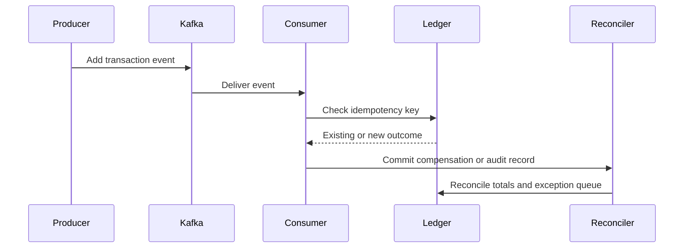

# Component replication strategies

## 1. Aurora PostgreSQL

### Recommended architecture

| Configuration | Value |
|---|---|
| Primary region | Mumbai |
| Recovery region | Hyderabad |
| Storage | Aurora PostgreSQL multi-AZ storage |
| Replication | Cross-region continuous replication |
| Failover mechanism | Aurora failover and controlled promotion |
| Minimum recovery readiness | Pre-provisioned endpoint and instance classes |
| Protection | Continuous backup and point-in-time restore |

### Replication model

- Aurora writes are accepted by the Mumbai writer.
- Data is continuously replicated to the Hyderabad cluster.
- The secondary is not used for direct application writes.
- Replication lag is monitored continuously; if it exceeds an agreed threshold, writes are paused or placed on backlog-limited routes.
- A failover sequence verifies the replica is fully synchronized and its transaction sequence is valid before promotion.
- Database writes are protected by transaction IDs, application idempotency, and immutable ledger records.

### Replication controls

- Enforce primary/standby roles at the application data layer.
- Disable automatic writes to the standby.
- Use separate IAM roles for each role.
- Maintain continuous copies of backups and snapshots.
- Test both failover and restore-to-point-in-time actions.

### Failure handling

| Failure | Expected response |
|---|---|
| Single Aurora writer AZ | Aurora automatic failover within AZ |
| Regional Aurora unavailability | Promote Hyderabad cluster after validation |
| Replication lag above threshold | Route to monitored capacity and suspend nonessential transactions |
| Split-brain risk | Lock financial writes and require incident commander authorization |
| Data corruption | Restore from validated snapshot or point-in-time recovery |

## 2. DynamoDB

| Design item | Strategy |
|---|---|
| Data classes | Configuration, tokens, merchant metadata, rate limits, and routing state |
| Replication | DynamoDB Global Tables |
| Read behavior | Local region reads unless authorized cross-region dependency |
| Write behavior | Local writes with eventual regional convergence |
| Conflict handling | Last-write-wins only for non-financial attributes |
| Financial-state rule | Never use DynamoDB as final ledger |

### Control requirements

- Use strongly consistent reads for critical configuration paths.
- Do not use DynamoDB for authorization decisions when a stale config could affect a live payment.
- Maintain a versioned configuration record and apply only the confirmed version.
- Ensure table-level encryption and automated backups.
- Monitor lag through a DynamoDB replication health metric.

## 3. ElastiCache Redis

### Strategy

- Deploy one primary and one replica per region.
- Use clustering only when it supports predictable failover and data partitioning.
- Use a region-local cache for frequently read, low-risk data.
- Use TTLs and versioned keys for all cached objects.
- Do not use Redis for final payment authorization or settlement totals.

### Failover handling

- On primary failure, promote the replica and update database endpoints.
- Invalidate stale cache entries after service reconnection.
- Require application services to revalidate business state after failover.
- Use a transaction cache only for short-lived status and rate-limit indications.

## 4. Apache Kafka

### Topology

- Separate Kafka clusters in Mumbai and Hyderabad.
- Three brokers per cluster with non-overlapping AZ placement.
- Replication factor of three.
- Separate partitions for authorization, fraud, settlement, notification, and reconciliation.
- Consumer groups with idempotent processing.

### Replication

- MSK Replicator continuously copies selected topics to the peer region.
- Topic partitions must preserve key ordering.
- Event schema must be versioned.
- A consumer offsets table stores the last processed event for each partition.
- A recovery process can replay from the last stable offset.

### Failure handling

| Failure | Response |
|---|---|
| Single broker failure | AWS-managed broker replacement and partition balancing |
| Partition unavailable | Increase leader-election time and reduce consumer lag |
| Consumer lag | Pause noncritical consumers and scale workers |
| Kafka region outage | Consumer group fails over to the second region |
| Replication lag | Stop or delay operation that cannot safely rebuild state |

## 5. Data replay and reconciliation

Every financial event must support replay without duplicate execution.

## 6. RPO and RTO validation plan

- Measure the Aurora replicas over a sustained transaction benchmark.
- Measure the Kafka replicated event lag under normal and degraded loads.
- Test Redis failover against a simulated primary loss.
- Confirm global table lag for merchant profile and configuration data.
- Record the actual time from failure detection to completed failover.
- Require evidence from three separate test runs before approving production schedule.

## 7. Required operational safeguards

- No direct write access to the recovery database.
- No unrestricted consumer offset resets in production.
- No cross-region data purge without written approval.
- No change to replication until a rollback plan is prepared.
- Every recovery action must create an incident record and validation output.
